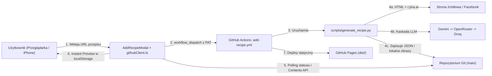

# Architektura aplikacji i model danych

## Przegląd architektury

Projekt łączy statycznie generowaną aplikację **Astro 5** (hostowaną na GitHub Pages oraz Vercel) z bezserwerowym zapleczem opartym o **GitHub Actions** i **GitHub REST API**. Repozytorium Git pełni jednocześnie rolę bazy danych (pliki JSON w `src/content/recipes/` oraz lokalne zdjęcia w `public/images/recipes/`).

---

## Kluczowe mechanizmy frontendowe

### 1. Obsługa ścieżki bazowej (`withBase`)

Aplikacja może działać zarówno pod katalogiem głównym `/` (localhost, Vercel), jak i w podkatalogu `/Ulubione-przepisy-Kasi/` (GitHub Pages).

- `astro.config.mjs` wykrywa zmienną `GITHUB_ACTIONS === 'true'` i ustawia `site: 'https://phxphoenix.github.io'` oraz `base: '/Ulubione-przepisy-Kasi'`.
- Funkcja `withBase(path)` w `src/utils/paths.ts` prefiksuje wszystkie wewnętrzne linki i zasoby (`import.meta.env.BASE_URL`), pozostawiając adresy zewnętrzne (`http://`, `https://`, `mailto:`, `tel:`, `//`, `#`) bez zmian.

### 2. Instant Preview i synchronizacja stanu (`instantRecipes.ts`)

Ponieważ pełny build i wdrożenie GitHub Pages trwają około 1–2 minut, aplikacja skraca czas oczekiwania użytkownika:

1. `AddRecipeModal.tsx` przed uruchomieniem `add-recipe.yml` zapisuje w `localStorage` (`kasia_recipe_tracker_job`) punkt odniesienia: listę istniejących plików w `src/content/recipes/` oraz ID ostatnich uruchomień workflow.
2. `RecipeGenerationTracker.tsx` co 4 sekundy odpytuje GitHub Actions API (`fetchWorkflowDispatchRuns`, `fetchWorkflowRunById`, `fetchWorkflowRunJobs`).
3. Po sukcesie joba `generate-recipe` pobiera nowy plik JSON bezpośrednio przez GitHub Contents API (`fetchRecipeJsonFile`), normalizuje go (`normalizeRecipePayload`) i zapisuje w `kasia_instant_recipes` (limit do 15 ostatnich wpisów).
4. `RecipeCatalog.tsx` łączy statycznie zbudowane przepisy z tymi w `localStorage`, oznaczając nowości etykietą **„Nowość – właśnie dodano!”**.
5. Funkcja `pruneBuiltInstantRecipes` usuwa wpisy z `localStorage`, gdy przepis trafi już do statycznego buildu (z 10-minutowym oknem na wyświetlenie odznaki nowości).
6. Analogicznie działa usuwanie: `markRecipeAsDeleted(slug)` natychmiast ukrywa kartę w przeglądarce (`kasia_deleted_recipes`), zanim workflow `delete-recipe.yml` zakończy przebudowę strony.

### 3. Magic Link i uwierzytelnianie GitHub

`src/utils/githubClient.ts` obsługuje:

- zapisywanie i odczyt Fine-Grained PAT pod kluczem `kasia_gh_token` w `localStorage` wraz z powiadamianiem komponentów zdarzeniem `kasia:token-changed`,
- budowanie linku parującego (`buildMagicLink`) z tokenem w fragmencie hash `#token=...`,
- odczyt i natychmiastowe czyszczenie tokenu z URL przy starcie aplikacji (`consumeMagicLinkFromUrl`) za pomocą `window.history.replaceState`.

---

## Model danych przepisu (`Recipe`)

Schemat jest zdefiniowany podwójnie — w TypeScript/Zod (`src/schemas/recipe.ts`) na potrzeby Astro Content Collections oraz w Pydantic (`scripts/generate_recipe.py`), aby gwarantować 100% zgodności przed zapisem do repozytorium.

| Pole | Typ | Wymagane | Opis i ograniczenia |
| --- | --- | --- | --- |
| `id` | `string` | opcjonalne | Identyfikator przepisu (zwykle równy `slug`) |
| `slug` | `string` | tak | Unikalny identyfikator URL bez polskich znaków |
| `title` | `string` | tak | Tytuł potrawy w języku polskim |
| `summary` | `string` | tak | Zwięzłe podsumowanie (1–2 zdania po polsku) |
| `category` | enum (6) | tak | `Śniadania`, `Zupy`, `Dania główne`, `Sałatki i przekąski`, `Desery i wypieki`, `Napoje i dodatki` |
| `tags` | `string[]` | domyślnie `[]` | Krótkie polskie tagi do wyszukiwania |
| `prepTimeMinutes` | `int >= 0` | opcjonalne | Czas przygotowania w minutach |
| `cookTimeMinutes` | `int >= 0` | opcjonalne | Czas obróbki cieplnej w minutach |
| `totalTimeMinutes` | `int >= 1` | tak | Całkowity czas wykonania w minutach |
| `servings` | `number > 0` | tak | Bazowa liczba porcji używana przez przelicznik |
| `difficulty` | enum (3) | tak | `Łatwy`, `Średni`, `Wymagający` |
| `images` | `RecipeImage[]` | tak (min. 1) | Lista zdjęć (`url`, opcjonalne `caption`, `isMain`) |
| `videos` | `RecipeVideo[]` | domyślnie `[]` | Lista materiałów wideo (`youtube`, `instagram`, `tiktok`, `mp4`) |
| `ingredientGroups` | `IngredientGroup[]` | tak (min. 1) | Grupy składników; każda zawiera min. 1 element z `name` i opcjonalnymi `amount`, `unit`, `notes` |
| `steps` | `RecipeStep[]` | tak (min. 1) | Kolejne kroki (`stepNumber >= 1`, `instruction`, opcjonalne `title`, `tip`, `imageUrl`) |
| `chefTips` | `string[]` | domyślnie `[]` | Dodatkowe wskazówki Szefa Kuchni |
| `sourceUrl` | `URL` | tak | Pełny adres URL źródła |
| `sourceDomain` | `string` | tak | Domena bez prefiksu `www.` |
| `originalLanguage` | `string` | tak | Kod języka źródłowego (min. 2 znaki, np. `pl`, `en`) |
| `createdAt` | `string (ISO)` | tak | Data utworzenia w formacie ISO 8601 |
